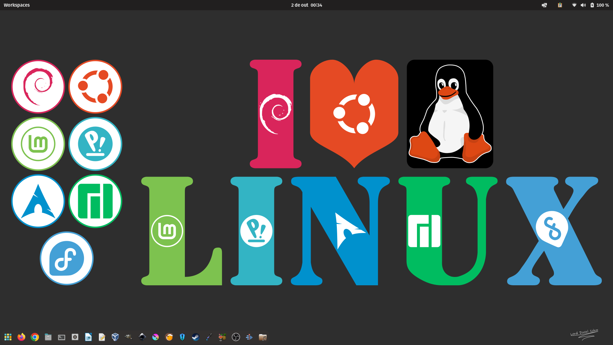
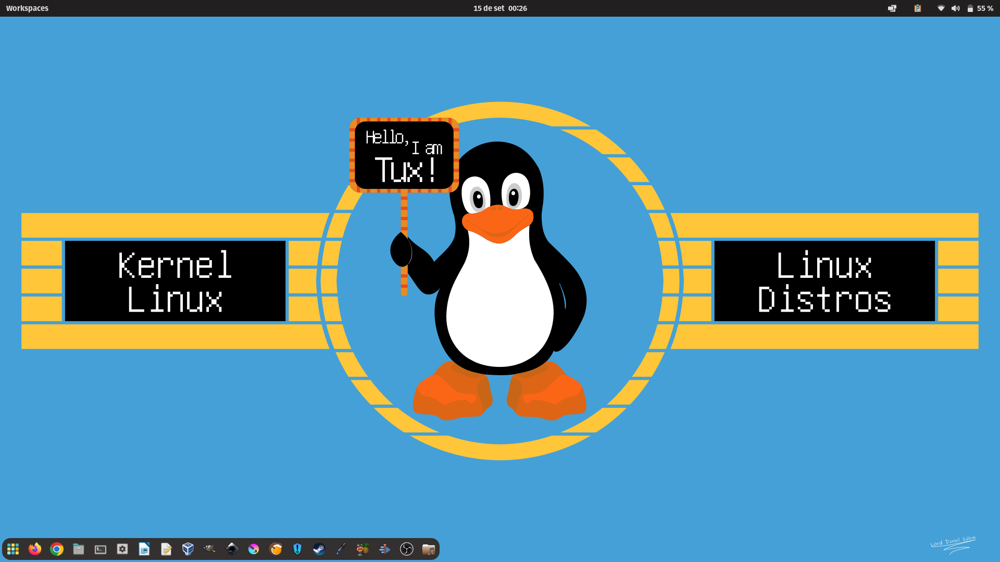
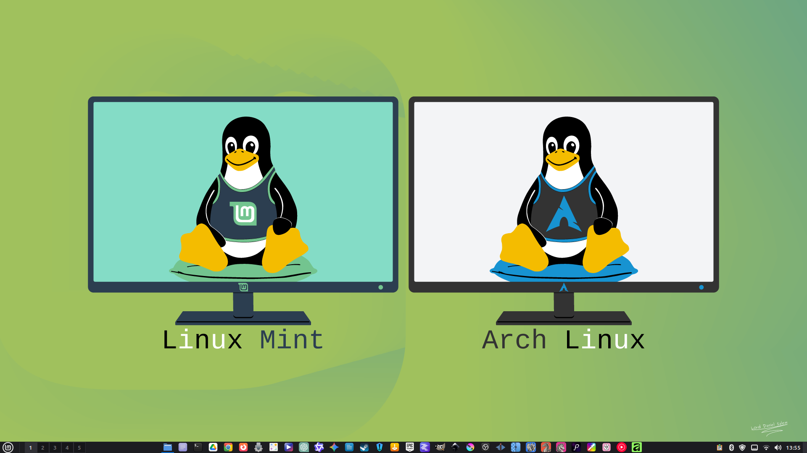
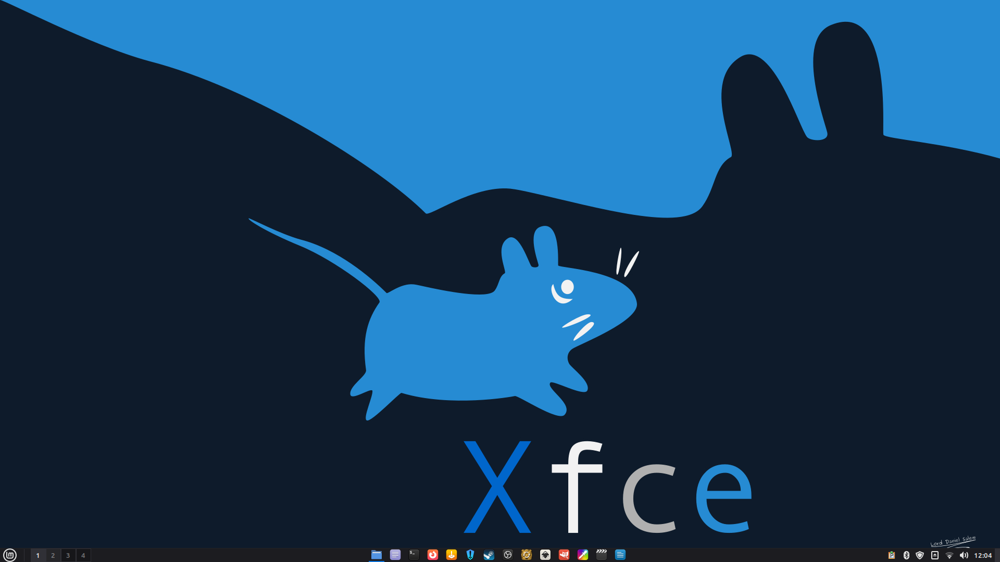
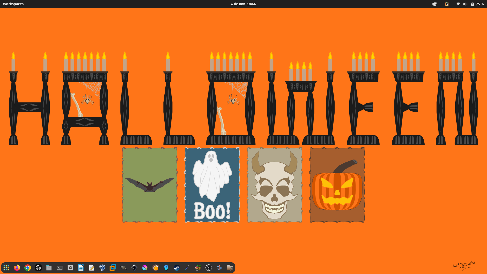
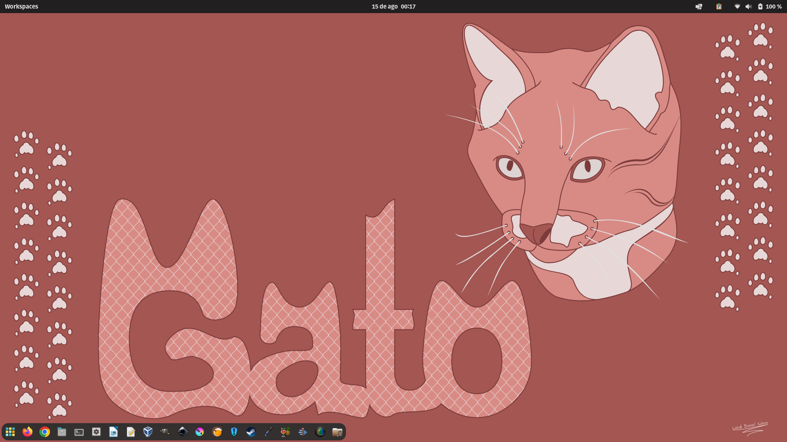
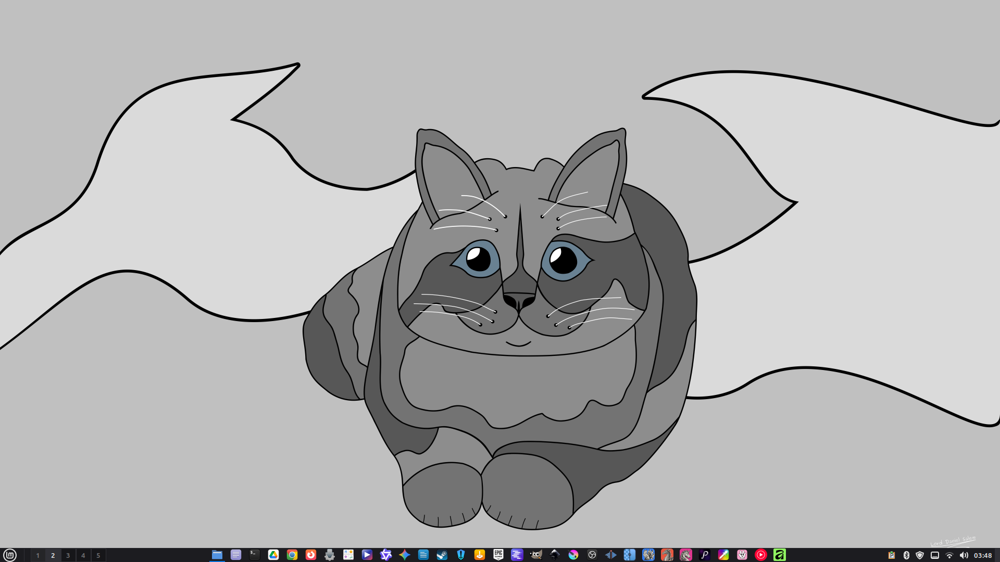

# Meus Wallpapers

Wallpapers criados por mim para personalizar seu desktop.

Programas que utilizo nas minhas criações: GIMP, Inkscape, Krita, PhotoCraft e VectorCraft.

## Wallpapers Linux

**Título:** I Love Linux 1 
**Sistema Operacional:** Pop!_OS 
**Ferramenta:** Inkscape 
**Largura:** 1920 pixels 
**Altura:** 1080 pixels

[Baixar](https://github.com/LDSalemPlayonLinux/slm19mwallpapers/raw/refs/heads/master/Linux/Wallpaper-I-Love-Linux-1-1920x1080.zip)

**Título:** Tux Linux 1 
**Sistema Operacional:** Pop!_OS 
**Ferramenta:** Inkscape 
**Largura:** 1920 pixels 
**Altura:** 1080 pixels

[Baixar](https://github.com/LDSalemPlayonLinux/slm19mwallpapers/raw/refs/heads/master/Linux/Wallpaper-Tux-Linux-1-1920x1080.zip)

**Título:** Tux Linux 2 
**Sistema Operacional:** Linux Mint 
**Ferramenta:** VectorCraft 
**Largura:** 1920 pixels 
**Altura:** 1080 pixels

[Baixar](https://github.com/LDSalemPlayonLinux/slm19mwallpapers/raw/refs/heads/master/Linux/Wallpaper-Tux-Linux-2-1920x1080.zip)

**Título:** Xfce 1 
**Sistema Operacional:** Linux Mint 
**Ferramenta:** Inkscape 
**Largura:** 1920 pixels 
**Altura:** 1080 pixels

[Baixar](https://github.com/LDSalemPlayonLinux/slm19mwallpapers/raw/refs/heads/master/Linux/Wallpaper-Xfce-1-1920x1080.zip)

## Wallpapers Halloween

**Título:** Halloween 1 
**Sistema Operacional:** Pop!_OS 
**Ferramenta:** Inkscape 
**Largura:** 1920 pixels 
**Altura:** 1080 pixels

[Baixar](https://github.com/LDSalemPlayonLinux/slm19mwallpapers/raw/refs/heads/master/Halloween/Wallpaper-Halloween-1-1920x1080.zip)

## Wallpapers Gatos

**Título:** Gato 1 
**Sistema Operacional:** Pop!_OS 
**Ferramenta:** Inkscape 
**Largura:** 1920 pixels 
**Altura:** 1080 pixels

[Baixar](https://github.com/LDSalemPlayonLinux/slm19mwallpapers/raw/refs/heads/master/Gatos/Wallpaper-Gato-1-1920x1080.zip)

**Título:** Gato 2 
**Sistema Operacional:** Linux Mint 
**Ferramenta:** Inkscape 
**Largura:** 1920 pixels 
**Altura:** 1080 pixels

[Baixar](https://github.com/LDSalemPlayonLinux/slm19mwallpapers/raw/refs/heads/master/Gatos/Wallpaper-Gato-2-1920x1080.zip)
